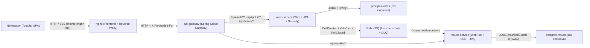

# Plan Maestro de Implementación — LiveVote

Roadmap técnico por fases (**F0–F9**) para construir **LiveVote** de principio a fin, con contratos verificables, pruebas automatizadas en cada etapa y las demostraciones obligatorias de microservicios.

---

## Estado actual y bitácora

- **Fase actual**: `F5` completada (`v0.5.0`) → **Siguiente**: `F6` (`Observabilidad, resiliencia y demos (c) y (d)`)
- **Última verificación exitosa**: `frontend` (`14/14` tests Jasmine/Karma en `ChromeHeadless` + `ng build` `352.65 kB`) + backend `0.5.0` (`17/17` votes + `19/19` results + `11/11` gateway) + `docker compose up -d --build` (7 contenedores `healthy`) con SSE sin buffering por `http://localhost:4200` (`curl -N` `> 22 s`) y recorrido E2E completo en navegador real (registro, creación 3 opciones, voto `201`, duplicado `409`, proyector SSE en vivo y cierre de encuesta).

### Bitácora de hitos

| Fase | Fecha | Estado | Evidencia / Comando verificado | Notas / Pendientes |
| :--- | :--- | :--- | :--- | :--- |
| **F0** | 2026-11-22 | ✅ Completada | `git status -u` + validación de `AGENTS.md` y 9 skills | Base del monorepo, reglas, contratos y bitácora listos |
| **F1** | 2026-11-26 | ✅ Completada (`v0.1.0`) | `mvn test` (`14/14`, Testcontainers `postgres:16.6-alpine`) + `docker compose up -d --build` + smoke HTTP | `votes-service` aislado + `postgres-votes` + Flyway V1 listos; Testcontainers fijado en `1.21.4` por Docker Engine 29 |
| **F2** | 2026-11-26 | ✅ Completada (`v0.2.0`) | `mvn test` (`17/17` votes + `11/11` results, Testcontainers Postgres+RabbitMQ) + Compose E2E (5 contenedores) | Refactor previo a *Package by Layer* (`82a2497`); RabbitMQ `AFTER_COMMIT`, idempotencia atómica y DLQ verificados |
| **F3** | 2026-11-27 | ✅ Completada (`v0.3.0`) | `mvn test` (`9/9` gateway + `17/17` votes + `11/11` results) + Compose E2E (6 contenedores) | Gateway único en `:8080`, JWT/`X-User-Id`, Caffeine `429`, Resilience4j `503` y puertos `8081`/`8082` internos |
| **F4** | 2026-11-27 | ✅ Completada (`v0.4.0`) | `mvn test` (`19/19` results + `11/11` gateway + `17/17` votes) + `curl -N` E2E (`> 22 s`) | SSE con snapshot, updates en vivo, `heartbeat` `~20 s`, limpieza sin fugas (`onErrorResume` + `doFinally`) y `response-timeout: -1` |
| **F5** | 2026-11-27 | ✅ Completada (`v0.5.0`) | `npm test` (`14/14`) + `npm run build` + `mvn test` (`47/47`) + Compose E2E (`nginx` SSE + navegador) | SPA Angular 20 LTS + `nginx` en `:4200`; hallazgo en frío (`TimeLimiter 4 s` vs lazy `RabbitTemplate`) anotado para F6 |

### Mediciones y demos obligatorias (pendientes)

- **Consumo real de RAM del stack** (`docker stats --no-stream`): *pendiente de medir en F8*.
- **Demo (a)** Escalar `votes-service` (`--scale`) y verificar reparto real en Gateway: *pendiente (F9)*.
- **Demo (b)** Detener `results-service`, votar y reiniciar sin pérdida de votos: *pendiente (F9)*.
- **Demo (c)** Detener y recuperar `postgres-results`: *pendiente (F6/F9)*.
- **Demo (d)** Detener y recuperar `postgres-votes`: *pendiente (F6/F9)*.

---

## 1. Arquitectura de referencia

### Decisiones estructurales clave

- **`identity` dentro de `votes-service`**: evita sumar un tercer microservicio y una tercera base PostgreSQL, preservando el presupuesto cero y bajo consumo de RAM.
- **Sin BFF**: existe un único canal cliente (SPA Angular responsive).
- **`results-service` con WebFlux + JPA**: expone SSE no bloqueante (`Flux` + `Sinks.Many`) y ejecuta JPA fuera del event loop (`Schedulers.boundedElastic()` / hilos del listener AMQP), evitando mantener drivers R2DBC + JDBC para Flyway.
- **Limitación conocida**: `results-service` corre en 1 instancia porque los streams SSE viven en memoria local (fan-out multi-instancia se evalúa como mejora opcional en F9).

---

## 2. Contratos de API REST (vía Gateway)

| Método y ruta | Servicio destino | Autenticación | Rate limit IP | Respuestas principales |
| :--- | :--- | :--- | :--- | :--- |
| `POST /api/auth/register` | `votes-service` | Pública | Sí | `201` (JWT), `400`, `409`, `429` |
| `POST /api/auth/login` | `votes-service` | Pública | Sí | `200` (JWT), `401`, `429` |
| `POST /api/polls` | `votes-service` | JWT (`X-User-Id`) | No | `201`, `400` (2–6 opciones), `401` |
| `GET /api/polls/mine` | `votes-service` | JWT (`X-User-Id`) | No | `200`, `401` |
| `POST /api/polls/{id}/close` | `votes-service` | JWT (`X-User-Id`, solo dueño) | No | `200`/`204`, `401`, `403`, `404` |
| `GET /api/polls/{id}` | `votes-service` | Pública | No | `200`, `404` |
| `POST /api/polls/{id}/votes` | `votes-service` | Pública (`deviceId`) | Sí | `201`, `404`, `409` (ya votó), `422` (cerrada), `429` |
| `GET /api/results/{id}` | `results-service` | Pública | No | `200`, `404` |
| `GET /api/results/{id}/stream` | `results-service` | Pública | No | `200` (`text/event-stream` + heartbeat ~20 s), `404` |

> **Regla de seguridad en `api-gateway`**: toda cabecera `X-User-Id` enviada por el cliente es eliminada en todas las rutas. Solo se inyecta con el `sub` del JWT validado en rutas protegidas.

---

## 3. Contratos de eventos asíncronos (RabbitMQ)

Exchange topic durable `livevote.events` + Dead Letter Exchange `livevote.dlx` -> DLQ durable `results.events.dlq`. Todos los mensajes incluyen `eventVersion: 1`, timestamps ISO-8601 UTC y cabecera `X-Trace-Id`.

- **`PollCreated`** (`poll.created`): `{eventVersion, pollId, title, options: [{optionId, text}], createdAt}` *(sin datos del dueño)*.
- **`VoteCast`** (`vote.cast`): `{eventVersion, voteId, pollId, optionId, castAt}`.
- **`PollClosed`** (`poll.closed`, F9): `{eventVersion, pollId, closedAt}`.

---

## 4. Hoja de ruta por fases (F0–F9)

### F0 — Bootstrap del monorepo y gobernanza
- [x] Inicializar Git (`git init`) y configurar `.gitignore`, `.gitattributes` (LF para Docker/WSL2), `.env.example` y `.env.prod.example`.
- [x] Crear estructura base independiente (`services/votes-service`, `services/results-service`, `services/api-gateway`, `frontend`, `.github/workflows`).
- [x] Redactar `AGENTS.md`, las 9 skills en `.agents/skills/`, `docs/PLAN.md` y `README.md` inicial.
- [x] **Verificación**: estructura limpia sin secretos ni código compartido; `AGENTS.md` < 24 KB sin frontmatter; 9 skills válidas.

### F1 — `votes-service` aislado + `postgres-votes`
- [x] Crear proyecto Maven en `services/votes-service` (Java 17, Spring Boot 3.x).
- [x] Implementar módulo `identity` (`POST /api/auth/register`, `POST /api/auth/login`, BCrypt, JWT HS256 2 h) y resolución dual de usuario (`X-User-Id` solo si `app.security.trust-gateway-header=true`, si no Bearer JWT).
- [x] Implementar módulo `polls` (`POST /api/polls` con 2–6 opciones, `GET /api/polls/mine`, `POST /api/polls/{id}/close` solo dueño, `GET /api/polls/{id}`, `POST /api/polls/{id}/votes`).
- [x] Definir migraciones Flyway en `postgres-votes` incluyendo restricción única `(poll_id, device_id)`.
- [x] Crear `docker-compose.yml` y `docker-compose.override.yml` iniciales con `postgres-votes` (volumen, base y usuario exclusivos).
- [x] **Verificación**: tests unitarios + test de integración con Testcontainers (PostgreSQL) en `mvn test` pasando al 100 %; `POST /api/polls/{id}/votes` responde `201`, `409` en duplicado, `404` si no existe y `422` si está cerrada.

### F2 — RabbitMQ y `results-service`
- [x] Agregar `rabbitmq` y `postgres-results` (volumen, base y usuario exclusivos) a Docker Compose con topología durable (`livevote.events`, `livevote.dlx`, `results.events.queue`, `results.events.dlq`).
- [x] Publicar eventos `PollCreated` (sin datos del dueño) y `VoteCast` en `votes-service` (`AFTER_COMMIT`).
- [x] Crear proyecto `services/results-service` (Spring WebFlux + Spring Data JPA fuera del event loop + Flyway en `postgres-results`).
- [x] Implementar consumo idempotente mediante tabla `processed_votes` (`vote_id` PK en la misma transacción) y política de errores (reintento con backoff para fallos transitorios; `AmqpRejectAndDontRequeueException` -> DLQ solo para poison messages).
- [x] Exponer `GET /api/results/{id}` (con lectura en `Schedulers.boundedElastic()`).
- [x] **Verificación**: tests unitarios + Testcontainers (PostgreSQL y RabbitMQ) pasando; un voto en `votes-service` actualiza `postgres-results`; evento duplicado no altera conteos; payload corrupto termina en `results.events.dlq`.

### F3 — `api-gateway` y red interna
- [x] Crear proyecto `services/api-gateway` (Spring Cloud Gateway + Resilience4j + validación JWT HS256).
- [x] Configurar enrutamiento (`/api/auth/**`, `/api/polls/**`, `/api/votes/**` -> `votes-service`; `/api/results/**` -> `results-service`).
- [x] Implementar sanitización global que elimina cualquier `X-User-Id` entrante y la reinyecta desde el `sub` del JWT solo en rutas protegidas.
- [x] Implementar rate limiting por IP en registro, login y voto, más Circuit Breaker con fallback controlado por ruta.
- [x] Aislar servicios internos en Compose con `app.security.trust-gateway-header=true` en `votes-service`.
- [x] **Verificación**: tests unitarios/integración de filtros JWT, stripping de `X-User-Id`, `429` y Circuit Breaker; enviar `X-User-Id` falsificado sin JWT devuelve `401`.

### F4 — Tiempo real (SSE con heartbeat)
- [x] Implementar `GET /api/results/{id}/stream` en `results-service` con `Flux` y `Sinks.Many` (snapshot inicial + actualizaciones en vivo + evento `heartbeat` cada ~20 s + limpieza al cancelar).
- [x] Ajustar timeouts / Circuit Breaker en `api-gateway` para no cortar streams SSE prolongados.
- [x] **Verificación**: `curl -N` a través de `api-gateway` recibe snapshot inmediato, delta instantáneo al emitir un voto y heartbeats cada ~20 s sin desconexión.

### F5 — Frontend Angular y `nginx`
- [x] Crear aplicación Angular moderna en `frontend/` (standalone, sin `NgModules`, `@if`/`@for` con `track`, guards funcionales e interceptor JWT funcional).
- [x] Persistir `deviceId` (UUID vía `crypto.randomUUID()`) y JWT en `localStorage`.
- [x] Implementar pantallas: Auth (login/registro), Mis encuestas y Crear (2–6 opciones, compartir link, cerrar), Votar (mobile-first, manejo de `201`/`409`/`404`/`422`) y Resultados en vivo (modo proyector con SSE envuelto en `Observable` y limpieza en `ngOnDestroy`).
- [x] Configurar `nginx.conf` (mismo origen `/api` hacia `api-gateway`, fallback SPA y `proxy_buffering off` / `proxy_http_version 1.1` / `proxy_read_timeout` largo para SSE) e integrar `frontend` a Compose.
- [x] **Verificación**: `npm test` y `npm run build` en verde; flujo end-to-end completo desde navegador vía `docker compose up`.

### F6 — Observabilidad, resiliencia y demos (c) y (d)
- [ ] Configurar logs JSON estructurados en los 3 servicios (sin passwords, secretos ni JWT) y propagación de `traceId` (`Gateway -> votes-service -> RabbitMQ -> results-service`).
- [ ] Habilitar Actuator (`/actuator/health/liveness`, `/actuator/health/readiness` reflejando cada BD y métricas Golden Signals).
- [ ] Ajustar HikariCP para recuperación automática ante reconexión de base de datos.
- [ ] **Verificación — Demo (c)**: detener `postgres-results`, confirmar votos `201` y encolamiento en RabbitMQ, reiniciar `postgres-results` y verificar actualización de conteos.
- [ ] **Verificación — Demo (d)**: detener `postgres-votes`, confirmar lectura/SSE en `results-service` y error controlado al votar/crear, reiniciar y verificar autorrecuperación.

### F7 — Imágenes Distroless multi-arquitectura y CI/CD
- [ ] Crear Dockerfiles multi-stage Distroless (`gcr.io/distroless/java17-debian12:nonroot` y `nginx` con tag fijo, cero `latest`) compatibles con `linux/amd64` y `linux/arm64`.
- [ ] Crear workflows en `.github/workflows/` disparados por ruta modificada (`services/*`, `frontend`) con build, tests + Testcontainers y publicación multi-arch con versionado semántico.
- [ ] **Verificación**: build local multi-arch con `docker buildx` exitoso; workflows YAML validados.

### F8 — Producción y medición real de RAM
> **Compuerta obligatoria previa**: ANTES de planificar o ejecutar F8, preguntar al usuario el destino de despliegue y verificar los límites vigentes de su plan gratuito.

- [ ] Consultar destino de despliegue al usuario y validar límites del plan gratuito elegido.
- [ ] Medir consumo real de RAM del stack completo (`docker stats --no-stream`) y documentarlo en la bitácora.
- [ ] Crear `docker-compose.prod.yml` (solo `nginx`/TLS expone puertos, `restart: unless-stopped`, `healthcheck` + `service_healthy`, `mem_limit` + `-XX:MaxRAMPercentage`, rotación de logs, volúmenes persistentes, perfil opcional Caddy TLS).
- [ ] Documentar y probar script de backup `pg_dump` para `postgres-votes` y `postgres-results` + script de smoke test post-despliegue.
- [ ] **Verificación**: despliegue en destino gratuito dentro de límites de RAM, TLS activo, backup probado y smoke test exitoso.

### F9 — Demos finales (a)–(d), documentación y mejoras opcionales
- [ ] **Demo (a)**: escalar `votes-service` (`docker compose up --scale votes-service=3`), investigar/configurar el balanceo en `api-gateway` (evitando pinning por keep-alive de Netty) y probar distribución real entre réplicas.
- [ ] **Demo (b)**: detener `results-service`, emitir votos, reiniciarlo y comprobar cero votos perdidos.
- [ ] Documentar evidencia de las 4 demos **(a)**–**(d)** en `docs/PLAN.md` y `README.md`.
- [ ] Completar `README.md` final con justificación de microservicios, trade-offs, consumo real de RAM medido y guía de uso/despliegue.
- [ ] Evaluar/implementar mejoras opcionales: evento `PollClosed` en vivo y estrategia de fan-out SSE para escalar `results-service`.
- [ ] **Verificación**: repositorio completo, reproducible con `docker compose up` y listo para evaluación y portfolio.
